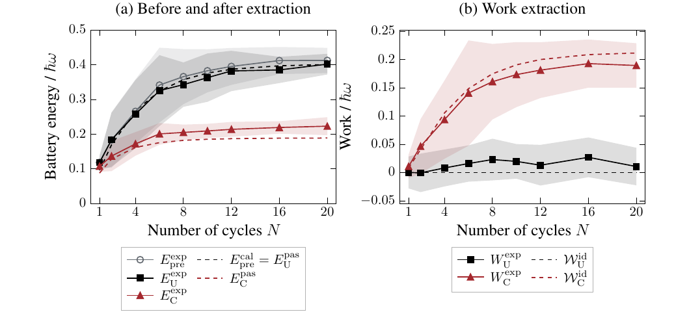

# Daemonic work extraction from a quantum battery monitored via residual ZZ coupling

[](https://doi.org/10.5281/zenodo.24527677)
[](LICENSE)
[](LICENSE-DATA)

Data and code for the article

> S. N. Elyasi, *Daemonic work extraction from a quantum battery monitored via residual ZZ coupling* (2026).

A transmon on IBM Quantum Phoenix (Q86) serves as a two-level quantum battery. The
residual ZZ coupling to its four neighbours (Q76, Q85, Q87, Q96) shifts their
frequencies by an amount that depends on the battery occupation, so Ramsey readouts
of these spectators form a measurement record of the battery. A real-time controller
uses the two most recent spectator outcomes to choose the extraction pulse. The
repository contains every measurement record, the calibration, and the code that
regenerates the reported results and figures.

<p align="center">
  
</p>

## Contents

| Manuscript | Data | Produced by |
|---|---|---|
| Fig. 4, Table III, Sec. VIII B | `data/phoenix-2026-11-22-matched-feedback/` | `scripts/reproduce_results.py` → `results/` |
| Fig. 7 | `data/phoenix-2026-11-22-matched-feedback/` | `scripts/reproduce_results.py` → `results/branch-populations.json` |
| Appendix N (calibration, intervals) | `data/phoenix-2026-11-22-matched-feedback/calibration/` | `scripts/verify_archive.py`, `scripts/audit_measurements.py` |
| Table I, Fig. 5, Appendix L | `data/phoenix-2026-11-17-single-cycle/` | `data/processed/table1-*.csv`, `fig5*-*.csv` |
| Fig. 6, Table II, Appendix M | `data/processed/fig6-ramsey-check.csv`, `table2-ramsey-shifts.csv` | `zzbattery.ramsey` |
| Figs. 4-7 (vector PDFs) | `results/`, `data/processed/` | `scripts/make_figures.py` → `figures/` |

```
├── src/zzbattery/        Python package
│   ├── design.py         fixed experimental design (layout, couplings, seeds, cycle numbers)
│   ├── circuits.py       sensing circuits, real-time extraction predicate, acquisition plans
│   ├── calibration.py    outcome matrices and the frozen extraction rule
│   ├── analysis.py       work, energy budget, branch populations, bootstrap intervals
│   ├── ramsey.py         Ramsey fits of the residual ZZ shifts
│   ├── archive.py        reading, hashing and comparing archived records
│   ├── hardware.py       staging, submission and retrieval on IBM Quantum
│   └── single_cycle.py   single-cycle experiment and its noise model
├── scripts/              command-line entry points
├── notebooks/            acquisition notebook of the single-cycle experiment
├── data/                 raw and processed measurement data
├── results/              released results of the matched-feedback experiment
├── figures/              Figs. 4-7 of the manuscript (PDF)
└── tests/                reproducibility and consistency tests
```

## Reproducing the results

The analysis runs offline and needs no IBM Quantum account. Python 3.11 or newer is
required; the released results were produced with Python 3.13 and the versions in
`requirements.txt`.

```bash
python -m venv .venv && source .venv/bin/activate
make install        # pinned dependencies and the zzbattery package
make verify         # hashes of all records, calibration reconstruction, qualification
make results        # regenerate results/ into build/results and compare with the release
make audit          # independent reimplementation of the primary estimates
make figures        # Figs. 4-7 into build/figures (requires LaTeX with Times and cm-super)
make test           # full test suite
```

`make results` reports the primary comparison,

```
Daemonic gain at N = 16: 0.1659 hbar*omega, 95% interval [0.1521, 0.1804]
```

and confirms that every regenerated file agrees with `results/`. Integers, strings and
controller decisions are compared exactly and floating-point values to a relative
tolerance of 10⁻¹²; the last digits can differ between linear-algebra libraries.

The tests also rebuild the 2,592 measurement circuits and the 64 calibration
circuits from the seeds in `src/zzbattery/design.py` and check that their metadata,
including every charging phase, equal the archived manifests.

## Data

`data/phoenix-2026-11-22-matched-feedback/` holds the compiled circuits (QPY), the
individual shot records and the manifests of the qualification, calibration and the
four measurement jobs: 9 cycle numbers × 32 charging-phase sequences × 3 circuit
types × 384 shots. The extraction rule in `calibration/frozen-calibration.json` was
computed from the calibration shots before any measurement circuit was compiled, and
every measurement manifest records its SHA-256. File formats are described in the
[data README](data/phoenix-2026-11-22-matched-feedback/README.md).

`data/phoenix-2026-11-17-single-cycle/` holds the single-cycle experiment and
`data/processed/` the tables behind Figs. 5 and 6 and Tables I and II
([description](data/processed/README.md)). `SHA256SUMS` lists the hash of every
file in `data/`, `results/` and `figures/`.

No credentials or account identifiers are included.

## Running on hardware

New acquisitions need an IBM Quantum account with access to `ibm_phoenix` and the
`hardware` extra (`pip install -e ".[hardware]"`). Credentials are read from
`IBM_QUANTUM_TOKEN` and `IBM_QUANTUM_INSTANCE` or from a saved Qiskit Runtime account.

```bash
python scripts/run_matched_campaign.py RUN_DIR --qualification-table TABLE.json
```

Each job is staged to disk before submission and its identifier is recorded before
results are requested, so an interrupted run resumes without duplicate submissions.
Dynamical decoupling and twirling are disabled because they would remove the ZZ
phase used for sensing.

## Citation

Please cite the article and this archive. The archive is preserved on Zenodo:
version 1.0.0, [10.5281/zenodo.24527678](https://doi.org/10.5281/zenodo.24527678)
(all versions: [10.5281/zenodo.24527677](https://doi.org/10.5281/zenodo.24527677)).
See also [`CITATION.cff`](CITATION.cff).

```bibtex
@software{elyasi_2026_zzbattery,
  author    = {Elyasi, Seyed Navid},
  title     = {Daemonic work extraction from a quantum battery monitored via residual {ZZ} coupling: data and code},
  version   = {1.0.0},
  publisher = {Zenodo},
  year      = {2026},
  doi       = {10.5281/zenodo.24527678},
  url       = {https://doi.org/10.5281/zenodo.24527678}
}
```

## License

Code: [MIT](LICENSE). Data, results and figures: [CC BY 4.0](LICENSE-DATA).

## Contact

Seyed Navid Elyasi, Department of Electrical Engineering, Chalmers University of
Technology — elyasi@chalmers.se
